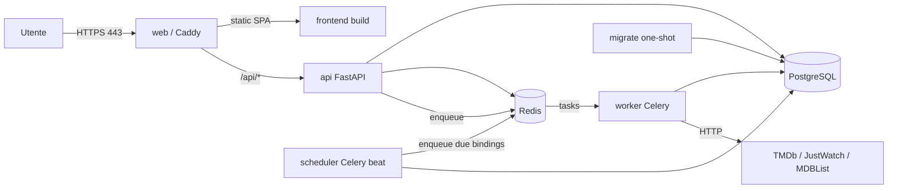
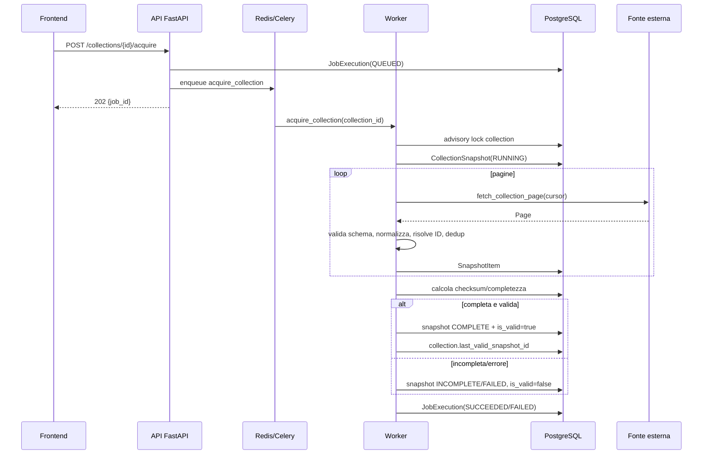
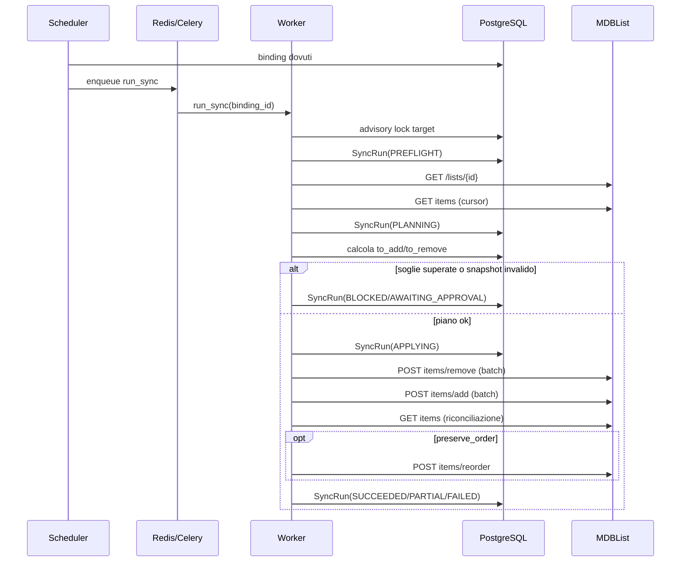

# Fase 1 — Architettura

**Stato:** progetto di Fase 1, nessun servizio applicativo implementato.
**Vincoli di riferimento:** monolite modulare, processi separati per web/worker/scheduler, PostgreSQL come fonte di verità, Redis solo come broker/cache, nessun job lungo nel processo HTTP.

---

## 1. Decisioni in breve

| Decisione | Scelta | Alternativa scartata |
|---|---|---|
| Forma del sistema | Monolite modulare con 4 processi (web, api, worker, scheduler) | Microservizi indipendenti, Kubernetes |
| Fonte di verità | PostgreSQL | Redis, file JSON, stato in memoria |
| Coda e pianificazione | Celery + Redis; beat nel processo `scheduler` | `BackgroundTasks` FastAPI, cron di sistema |
| Acquisizione | Snapshot immutabili con flag di completezza | Aggiornamento in place della collezione |
| Provenienza | Enum `OFFICIAL` / `AGGREGATOR` / `CUSTOM` + `date_basis` | Un unico campo "fonte" generico |
| Connettori | Interfaccia con capability flags dichiarate | Interfaccia unica che presume tutte le capacità |
| Sync | Operation ledger + riconciliazione remota | Transazione distribuita DB/API |
| Ordine | Reorder MDBList opzionale, best-effort, max 1.000 per chiamata | Cancellare e ricreare la lista |
| Concorrenza | Advisory lock per target + unique partial index | Lock in memoria o "speranza" |
| Segreti | AES-256-GCM con chiave esterna al DB | Segreti in `.env` o in chiaro nel DB |
| Frontend | SPA React + client generato da OpenAPI | SSR, client scritto a mano |
| Target MDBList | ID numerico stabile; slug/URL solo display | Usare lo slug come chiave |

---

## 2. Topologia dei processi



| Processo | Responsabilità | Non deve fare |
|---|---|---|
| `web` | TLS, serving SPA, reverse proxy `/api`, header di sicurezza | Logica applicativa, accesso al DB |
| `api` | Autenticazione, validazione, query, enqueue job, OpenAPI | Scraping, sync, job lunghi, `BackgroundTasks` |
| `worker` | Acquisizione, normalizzazione, sync, riconciliazione, retry | Servire HTTP all'utente |
| `scheduler` | Celery beat: calcola i binding dovuti, enqueue manutenzione | Eseguire sync nel proprio processo |
| `migrate` | `alembic upgrade head` e seed | Restare in esecuzione |
| `postgres` | Stato persistente, lock, storico | Esposizione pubblica |
| `redis` | Broker Celery, cache, rate limit | Fonte di verità |

**Regola:** l'API non esegue mai un'acquisizione o una sync. Risponde `202 Accepted` con un `job_id`/`run_id` e il frontend fa polling.

---

## 3. Struttura del repository

```text
MdbUP/
├── backend/
│   ├── pyproject.toml
│   ├── uv.lock
│   ├── alembic.ini
│   ├── alembic/
│   │   ├── env.py
│   │   └── versions/
│   ├── app/
│   │   ├── main.py
│   │   ├── api/
│   │   │   ├── deps.py
│   │   │   ├── errors.py
│   │   │   └── routers/
│   │   │       ├── auth.py
│   │   │       ├── dashboard.py
│   │   │       ├── providers.py
│   │   │       ├── sources.py
│   │   │       ├── collections.py
│   │   │       ├── mdblist.py
│   │   │       ├── bindings.py
│   │   │       ├── sync_runs.py
│   │   │       ├── settings.py
│   │   │       └── health.py
│   │   ├── core/
│   │   │   ├── config.py
│   │   │   ├── logging.py
│   │   │   ├── crypto.py
│   │   │   ├── security.py
│   │   │   └── time.py
│   │   ├── domain/
│   │   │   ├── enums.py
│   │   │   ├── models.py
│   │   │   ├── errors.py
│   │   │   └── policies.py
│   │   ├── services/
│   │   │   ├── acquisition.py
│   │   │   ├── normalization.py
│   │   │   ├── sync_planner.py
│   │   │   ├── sync_executor.py
│   │   │   ├── reconciliation.py
│   │   │   ├── dashboard.py
│   │   │   └── credentials.py
│   │   ├── connectors/
│   │   │   ├── base.py
│   │   │   ├── registry.py
│   │   │   ├── tmdb/
│   │   │   │   ├── connector.py
│   │   │   │   ├── client.py
│   │   │   │   └── mapper.py
│   │   │   ├── justwatch/
│   │   │   │   ├── connector.py
│   │   │   │   ├── client.py
│   │   │   │   ├── export.py
│   │   │   │   └── mapper.py
│   │   │   └── manual_csv/
│   │   │       └── connector.py
│   │   ├── repositories/
│   │   │   ├── providers.py
│   │   │   ├── collections.py
│   │   │   ├── snapshots.py
│   │   │   ├── bindings.py
│   │   │   ├── sync_runs.py
│   │   │   └── settings.py
│   │   ├── jobs/
│   │   │   ├── celery_app.py
│   │   │   ├── scheduler.py
│   │   │   └── tasks/
│   │   │       ├── acquisition.py
│   │   │       ├── sync.py
│   │   │       └── maintenance.py
│   │   ├── integrations/
│   │   │   ├── mdblist/
│   │   │   │   ├── client.py
│   │   │   │   ├── models.py
│   │   │   │   └── mapper.py
│   │   │   └── tmdb/
│   │   │       ├── client.py
│   │   │       └── models.py
│   │   └── db/
│   │       ├── base.py
│   │       ├── session.py
│   │       └── models/
│   ├── tests/
│   │   ├── unit/
│   │   ├── integration/
│   │   ├── contract/
│   │   ├── e2e/
│   │   └── fixtures/
│   └── scripts/
├── frontend/
│   ├── package.json
│   ├── vite.config.ts
│   ├── src/
│   │   ├── main.tsx
│   │   ├── App.tsx
│   │   ├── api/
│   │   │   ├── client.ts
│   │   │   └── schema.d.ts
│   │   ├── components/
│   │   ├── features/
│   │   │   ├── auth/
│   │   │   ├── dashboard/
│   │   │   ├── providers/
│   │   │   ├── collections/
│   │   │   ├── bindings/
│   │   │   ├── sync/
│   │   │   └── settings/
│   │   ├── lib/
│   │   ├── routes/
│   │   └── styles/
│   └── e2e/
├── deploy/
│   ├── docker-compose.yml
│   ├── Caddyfile
│   ├── Dockerfile.api
│   ├── Dockerfile.web
│   └── backup/
├── docs/
│   └── phase1/
├── scripts/
│   ├── backup.sh
│   └── restore.sh
├── .env.example
└── README.md
```

### Regola di dipendenza

```text
api ──────────────► services ──────────────► domain
                         │
                         ├──► repositories ───► db
                         ├──► connectors ─────► integrations
                         └──► jobs? (no: jobs chiamano services)
```

- `domain` non importa FastAPI, SQLAlchemy, HTTPX o Celery.
- `api` non contiene query SQL complesse né logica di sync.
- `services` orchestra casi d'uso e non conosce FastAPI.
- `connectors` conosce solo la fonte esterna e restituisce modelli normalizzati.
- `repositories` è l'unico layer che parla con SQLAlchemy.
- `jobs` è un adapter sottile: deserializza l'input, chiama un servizio, registra lo stato.
- `integrations` contiene client HTTP e traduzione payload, senza regole di business.

---

## 4. Interfaccia `SourceConnector`

```python
from __future__ import annotations

from dataclasses import dataclass, field
from datetime import date
from enum import StrEnum
from typing import Any, Protocol, Sequence


class MediaType(StrEnum):
    MOVIE = "MOVIE"
    SHOW = "SHOW"


class CollectionKind(StrEnum):
    CATALOG = "CATALOG"
    RECENTLY_ADDED = "RECENTLY_ADDED"
    UPCOMING = "UPCOMING"
    CHART = "CHART"
    CUSTOM_FILTER = "CUSTOM_FILTER"


class CollectionOrigin(StrEnum):
    OFFICIAL = "OFFICIAL"
    AGGREGATOR = "AGGREGATOR"
    CUSTOM = "CUSTOM"


class DateBasis(StrEnum):
    PROVIDER_OFFICIAL = "PROVIDER_OFFICIAL"
    AGGREGATOR_FIRST_SEEN = "AGGREGATOR_FIRST_SEEN"
    APP_FIRST_SEEN = "APP_FIRST_SEEN"
    UNKNOWN = "UNKNOWN"


@dataclass(frozen=True)
class ConnectorCapabilities:
    catalog: bool = False
    recently_added: bool = False
    upcoming: bool = False
    charts: bool = False
    ordering: bool = False
    added_dates: bool = False
    seasons_episodes: bool = False
    full_pagination: bool = False
    data_export: bool = False
    requires_credentials: bool = True
    requires_contract: bool = False
    max_page_size: int = 100
    notes: str = ""


@dataclass(frozen=True)
class SourceProvider:
    external_id: str
    name: str
    country_code: str = "IT"


@dataclass(frozen=True)
class SourceCollection:
    key: str
    name: str
    provider_external_id: str
    media_type: MediaType
    kind: CollectionKind
    origin: CollectionOrigin
    date_basis: DateBasis
    source_url: str | None = None
    metadata: dict[str, Any] = field(default_factory=dict)


@dataclass(frozen=True)
class RawItem:
    source_item_id: str
    media_type: MediaType
    title: str
    year: int | None = None
    tmdb_id: int | None = None
    imdb_id: str | None = None
    tvdb_id: int | None = None
    source_date_created: date | None = None
    source_payload: dict[str, Any] = field(default_factory=dict)


@dataclass(frozen=True)
class Page:
    items: Sequence[RawItem]
    next_cursor: str | None
    total_pages: int | None = None
    total_items: int | None = None
    raw: dict[str, Any] = field(default_factory=dict)


@dataclass(frozen=True)
class NormalizedItem:
    media_type: MediaType
    tmdb_id: int | None
    imdb_id: str | None
    title: str
    year: int | None
    offer_types: frozenset[str]
    source_date_created: date | None
    date_basis: DateBasis
    raw: dict[str, Any]


class NotSupportedError(RuntimeError):
    """La fonte non supporta questa capacità."""


class SourceConnector(Protocol):
    key: str
    capabilities: ConnectorCapabilities

    async def healthcheck(self) -> bool: ...

    async def list_providers(self, country_code: str) -> Sequence[SourceProvider]: ...

    async def list_collections(self, country_code: str) -> Sequence[SourceCollection]: ...

    async def fetch_collection_page(
        self,
        collection: SourceCollection,
        cursor: str | None,
        page_size: int,
    ) -> Page: ...

    def normalize_item(self, raw: RawItem) -> NormalizedItem: ...

    async def aclose(self) -> None: ...
```

### Regole

1. Ogni connettore dichiara le capacità **reali**. Se una capacità è `False`, il metodo corrispondente può sollevare `NotSupportedError`.
2. L'UI usa le capacità per disabilitare le collezioni non disponibili e mostra il motivo.
3. `normalize_item` non inventa ID: se manca `tmdb_id`, il resolver TMDb prova a risolvere da IMDb; se fallisce, l'item resta `UNRESOLVED`.
4. `source_date_created` è la data dichiarata dalla fonte, non `first_seen_at`.
5. `Page.next_cursor` è l'unico modo per proseguire; `total_pages`/`total_items` sono segnali di completezza, non garanzie.

### Matrice capacità connettori

| Connettore | catalogo | aggiunte recenti | prossime uscite | classifiche | ordinamento | date aggiunta | stagioni/episodi | paginazione completa | data export | Stato |
|---|---|---|---|---|---|---|---|---|---|---|
| `tmdb` | ✅ disponibilità corrente | ❌ | ❌ (solo uscite cinema) | ❌ | limitato | ❌ | ✅ metadati | ❌ (cap 500 pagine) | ❌ | **Con API key** |
| `justwatch_partner` | ✅ | ✅ | ✅ | ✅ | ✅ | ✅ `date_created` | ✅ | ✅ | ✅ | **BLOCCATO contratto** |
| `justwatch_export` | ✅ | ✅ (da verificare nel dump) | ❌ | ❌ | ordine sorgente | ✅ (da verificare) | ❌ (da verificare) | ✅ | ✅ | **BLOCCATO contratto** |
| `manual_csv` | ✅ | ❌ | ❌ | ❌ | ✅ | ❌ | ❌ | ✅ | ❌ | **Disponibile** |

**Nota MDBList:** il target supporta `POST /lists/{listid}/items/reorder` (max 1.000 elementi per chiamata, ordine custom `usort`). Il reorder è un'operazione opzionale del sync executor, non una capacità della fonte. Non è atomico per liste >1.000 e non va usato per simulare un ordine non disponibile nella sorgente.

**Nota:** `tmdb` non è una fonte ufficiale del provider. È un aggregatore (dati watch provider powered by JustWatch). Le collezioni TMDb sono sempre `AGGREGATOR`.

---

## 5. Flusso di acquisizione



### Completezza

Uno snapshot è `COMPLETE` solo se:

- tutte le pagine attese sono state lette (`pages_fetched == pages_expected`, quando la fonte espone un totale);
- non ci sono errori di schema o di rete non recuperati;
- il cursore non è entrato in loop;
- il numero di item letti è coerente con `total_items`, se disponibile;
- il checksum è stato calcolato.

`is_valid` richiede `COMPLETE`, `items_count > 0` e `unresolved_count == 0` (per MIRROR). Per APPEND_ONLY, `COMPLETE` con warning può bastare, ma le aggiunte non risolte vengono saltate.

### Snapshot immutabile

- Ogni acquisizione crea un nuovo `CollectionSnapshot`.
- Non si aggiorna mai uno snapshot esistente, salvo il passaggio `RUNNING -> COMPLETE/INCOMPLETE/FAILED`.
- `collection.last_valid_snapshot_id` punta all'ultimo snapshot valido.
- La sync usa solo `last_valid_snapshot_id`; se non esiste, la sync è `BLOCKED`.

### Deduplicazione

- Chiave: `(media_type, tmdb_id)`.
- Se `tmdb_id` manca, `(media_type, imdb_id)`.
- Mai il titolo.
- Lo stesso ID numerico TMDb può esistere per un film e per una serie: `media_type` è sempre nella chiave.
- Duplicati nella stessa pagina: tiene la prima occorrenza, incrementa `duplicate_count`.

---

## 6. Orchestrazione job

### Code

| Coda | Task | Concorrenza | Note |
|---|---|---|---|
| `acquisitions` | `acquire_collection` | 2 | Una acquisizione per collezione alla volta (advisory lock). |
| `sync` | `run_sync` | 2 | Un run per target alla volta (advisory lock). |
| `maintenance` | `enqueue_due_bindings`, `cleanup_old_data`, `healthcheck_sources` | 1 | Task brevi e idempotenti. |

### Scheduler

- `scheduler` esegue `celery beat`.
- Ogni 60 secondi: `enqueue_due_bindings`.
- Il task:
  1. `SELECT ... FROM sync_bindings WHERE is_enabled AND next_run_at <= now() FOR UPDATE SKIP LOCKED`;
  2. per ogni binding, verifica che non ci sia un run attivo;
  3. enqueue `run_sync(binding_id, trigger="SCHEDULED")`;
  4. calcola `next_run_at` con `croniter` nel fuso `Europe/Rome`, salva in UTC.
- La pianificazione è **DB-driven**, non una entry di beat per binding: aggiungere/rimuovere binding non richiede reload del beat.
- `cleanup_old_data` giornaliero: snapshot/run/operation oltre la retention; audit log oltre 180 giorni (configurabile).
- `healthcheck_sources` orario: aggiorna `Source.status` e `last_healthcheck_at`.

### Idempotenza

- `JobExecution` ha `task_id` unico.
- `SyncRun` ha un unique partial index su `binding_id` per gli stati attivi.
- `SyncBinding` ha un unique partial index su `target_id` dove `is_enabled = true`.
- Le task rileggono lo stato dal DB prima di agire; un doppio enqueue non crea un secondo run.

### Retry

- Retry automatico solo per errori transitori (`429`, `5xx`, timeout di rete).
- Backoff esponenziale con jitter, max 5 tentativi.
- `Retry-After` ha precedenza sul backoff.
- Errori `400`, `401`, `403`, `404`, schema cambiato: **no retry**, stato `FAILED`/`BLOCKED`.
- Dopo un timeout di scrittura: `UNCERTAIN`, riconciliazione remota prima di ritentare.

---

## 7. Flusso di sincronizzazione



### Punti di fallimento

| Punto | Gestione |
|---|---|
| Lettura lista remota incompleta | `BLOCKED`, nessuna scrittura |
| Snapshot non valido | `BLOCKED`, nessuna scrittura |
| Snapshot vuoto | `BLOCKED`, nessuna rimozione |
| Soglia rimozioni superata | `AWAITING_APPROVAL`, nessuna scrittura |
| Timeout su add/remove | `UNCERTAIN`, rileggi lista, poi decidi |
| Parziale | `PARTIAL`, operazioni fallite riprovabili |
| Reorder fallito | `SUCCEEDED` con warning `ORDER_NOT_ENFORCED`; contenuto corretto, ordine parziale |
| 401/403 | `FAILED`/`BLOCKED`, credenziale o permesso da correggere |

### Perché non una transazione distribuita

Non esiste atomicità tra PostgreSQL e MDBList. Il sistema usa:

- un **operation ledger** persistente;
- una **riconciliazione** finale con lettura remota;
- stati espliciti `UNCERTAIN` e `PARTIAL`;
- una UI che mostra chiaramente cosa è stato applicato.

---

## 8. Tassonomia errori

```python
class AppError(Exception):
    category: str          # AUTH | VALIDATION | SOURCE | TARGET | POLICY | CONFLICT | INTERNAL
    code: str              # es. SOURCE_RATE_LIMITED
    message: str           # messaggio utente in italiano
    retryable: bool
    details: dict
```

| Categoria | Esempi | UI |
|---|---|---|
| `AUTH` | `AUTH_INVALID_CREDENTIALS`, `AUTH_SESSION_EXPIRED` | Login / re-login |
| `VALIDATION` | `VALIDATION_INVALID_CRON`, `VALIDATION_BAD_TARGET` | Errore di form |
| `SOURCE` | `SOURCE_UNAVAILABLE`, `SOURCE_AUTH_FAILED`, `SOURCE_RATE_LIMITED`, `SOURCE_SCHEMA_CHANGED` | "Errore della fonte X" |
| `TARGET` | `MDBLIST_AUTH_FAILED`, `MDBLIST_PERMISSION_DENIED`, `MDBLIST_RATE_LIMITED`, `MDBLIST_UNCERTAIN` | "Errore MDBList" |
| `POLICY` | `SNAPSHOT_INCOMPLETE`, `SNAPSHOT_EMPTY`, `THRESHOLD_EXCEEDED`, `MANUAL_REVIEW_REQUIRED` | "Operazione bloccata per sicurezza" |
| `CONFLICT` | `SYNC_ALREADY_RUNNING`, `BINDING_DISABLED` | "Operazione già in corso" |
| `INTERNAL` | `INTERNAL_ERROR` | "Errore interno, riprova" |

**Regola UI:** un errore `SOURCE` non deve mai essere mostrato come errore MDBList, e viceversa. Il campo `category` determina il badge e il suggerimento.

---

## 9. ADR

### ADR-001 — Monolite modulare, non microservizi
**Contesto:** app single-user, team ridotto, deploy Docker Compose.
**Decisione:** un'unica codebase con layer espliciti e processi separati.
**Conseguenze:** semplicità operativa; nessun contratto di rete interno; disciplina sui confini dei moduli.

### ADR-002 — Processi separati per API, worker e scheduler
**Contesto:** job lunghi e sincronizzazioni non devono bloccare le richieste HTTP.
**Decisione:** `api`, `worker`, `scheduler` con la stessa immagine ma comandi diversi.
**Conseguenze:** più container; healthcheck distinti; nessun `BackgroundTasks`.

### ADR-003 — PostgreSQL fonte di verità
**Contesto:** stato di job, snapshot, run e operazioni deve sopravvivere ai restart.
**Decisione:** tutto lo stato persistente in PostgreSQL; Redis solo broker/cache.
**Conseguenze:** backup del DB obbligatorio; Redis può essere svuotato senza perdere dati.

### ADR-004 — Snapshot immutabili
**Contesto:** una sync non deve mai partire da dati parziali o mutati durante la lettura.
**Decisione:** ogni acquisizione crea uno snapshot; solo gli snapshot validi alimentano le sync.
**Conseguenze:** più spazio su disco; retention necessaria; storia completa.

### ADR-005 — Capability flags nei connettori
**Contesto:** fonti diverse hanno capacità diverse; non tutte hanno date, stagioni, paginazione completa.
**Decisione:** ogni connettore dichiara `ConnectorCapabilities`; l'UI disabilita ciò che non è supportato.
**Conseguenze:** niente fallimenti a runtime per capacità inventate; test di contratto per ogni flag.

### ADR-006 — Provenienza e `date_basis` espliciti
**Contesto:** categoria ufficiale, aggregatore e filtro personalizzato non sono la stessa cosa; la data di aggiunta può essere ufficiale, di aggregatore o di prima osservazione dell'app.
**Decisione:** enum `CollectionOrigin` e `DateBasis`; etichette distinte in DB e UI.
**Conseguenze:** nessuna sostituzione silenziosa; l'utente vede sempre la provenienza.

### ADR-007 — Operation ledger e riconciliazione
**Contesto:** MDBList non offre transazioni atomiche né idempotency key.
**Decisione:** ogni modifica remota è un `SyncOperation` persistito; dopo timeout si rilegge lo stato remoto.
**Conseguenze:** stato parziale visibile; ripresa affidabile; più codice di riconciliazione.

### ADR-008 — Lock per target e unique partial index
**Contesto:** due run concorrenti sulla stessa lista possono corrompere l'ordine o duplicare elementi.
**Decisione:** advisory lock PostgreSQL su `target_id` + unique partial index su `sync_bindings(target_id)` e `sync_runs(binding_id)` attivi.
**Conseguenze:** un solo writer per target; doppio avvio respinto con `CONFLICT`.

### ADR-009 — Segreti con AES-256-GCM e chiave esterna
**Contesto:** API key MDBList/TMDb e token JustWatch sono credenziali potenti.
**Decisione:** cifratura a riposo con chiave in env/secret manager, `key_version`, masking e redazione log.
**Conseguenze:** perdita della chiave = credenziali irrecuperabili; backup della chiave separato.

### ADR-010 — SPA + client OpenAPI generato
**Contesto:** frontend e backend devono restare allineati.
**Decisione:** FastAPI genera OpenAPI; `openapi-typescript` + `openapi-fetch` generano il client.
**Conseguenze:** type safety end-to-end; rigenerazione in CI; nessun client manuale duplicato.

### ADR-011 — Celery beat + query DB dei binding dovuti
**Contesto:** le pianificazioni sono per binding e cambiano dall'UI.
**Decisione:** beat esegue un task periodico che interroga i binding dovuti; non una entry di beat per binding.
**Conseguenze:** modifiche alla pianificazione immediate; un solo punto di verità (DB).

### ADR-012 — ID numerico MDBList come chiave, slug solo display
**Contesto:** lo slug/URL può cambiare con una rinomina; l'ID è stabile.
**Decisione:** `mdblist_targets.remote_list_id` è la chiave; slug/URL sono campi di display riletti.
**Conseguenze:** rinomine sicure; nessun binding rotto.

### ADR-013 — Reorder MDBList opzionale, non atomico
**Contesto:** lo schema live MDBList documenta `POST /lists/{listid}/items/reorder` con un limite di 1.000 elementi per chiamata; per liste più lunghe servono più chiamate e l'operazione non è atomica.
**Decisione:** `preserve_order` è opt-in, default `false`; il reorder è una `SyncOperation` separata, eseguita dopo la riconciliazione dei contenuti; un fallimento produce `SUCCEEDED` con warning `ORDER_NOT_ENFORCED`, non un rollback e non un `PARTIAL` (gli elementi ci sono tutti).
**Conseguenze:** l'ordine è best-effort; nessuna cancellazione/ricreazione della lista; l'UI dichiara il limite.

---

## 10. Cosa è implementabile ora e cosa è bloccato

| Area | Stato | Dipendenza |
|---|---|---|
| Docker Compose, DB, migrazioni, auth | **Implementabile subito** | Nessuna credenziale esterna |
| Frontend shell, dashboard, impostazioni | **Implementabile subito** | Backend Fase 2 |
| Connettore TMDb | **Implementabile con API key** | TMDb key |
| Connettore MDBList | **Implementabile con API key** | MDBList key |
| Sync MIRROR/APPEND_ONLY, soglie, lock, retry | **Implementabile subito** | Test con mock |
| Connettore JustWatch Partner API | **BLOCCATO** | Contratto + token |
| Connettore JustWatch Data Export | **BLOCCATO** | Contratto + credenziali S3 |
| Collezioni "Top 10 ufficiale" | **BLOCCATO/NON VERIFICATO** | Fonte ufficiale verificata |
| Collezioni "Aggiunte recenti" con data JustWatch | **BLOCCATO** | Contratto JustWatch |
| Collezioni "Aggiunte recenti" derivate | **Implementabile** | `first_seen_at` + etichetta `CUSTOM` |
| Reorder MDBList | **Implementabile con API key** | MDBList key; max 1.000 per chiamata |

---

## 11. File da creare in Fase 2

### Backend
- `backend/pyproject.toml`, `backend/uv.lock`
- `backend/app/main.py`
- `backend/app/core/config.py`, `logging.py`, `crypto.py`, `security.py`, `time.py`
- `backend/app/db/base.py`, `session.py`
- `backend/app/db/models/user.py`, `session.py`, `provider.py`, `source.py`, `collection.py`, `media.py`, `availability.py`, `snapshot.py`, `mdblist.py`, `sync.py`, `settings.py`, `audit.py`
- `backend/alembic.ini`, `backend/alembic/env.py`, `backend/alembic/versions/0001_initial.py`
- `backend/app/api/deps.py`, `errors.py`
- `backend/app/api/routers/auth.py`, `health.py`, `dashboard.py`, `providers.py`, `sources.py`, `collections.py`, `mdblist.py`, `bindings.py`, `sync_runs.py`, `settings.py`
- `backend/app/jobs/celery_app.py`, `scheduler.py`, `tasks/acquisition.py`, `tasks/sync.py`, `tasks/maintenance.py`
- `backend/app/connectors/base.py`, `registry.py`
- `backend/app/integrations/mdblist/client.py`, `models.py`, `mapper.py`
- `backend/app/integrations/tmdb/client.py`, `models.py`
- `backend/tests/conftest.py`, `unit/`, `integration/`, `contract/`, `e2e/`, `fixtures/`

### Frontend
- `frontend/package.json`, `package-lock.json`, `vite.config.ts`, `tsconfig.json`, `tailwind.config.ts`
- `frontend/src/main.tsx`, `App.tsx`, `routes/`
- `frontend/src/api/client.ts`, `schema.d.ts`
- `frontend/src/features/auth/`, `dashboard/`, `providers/`, `collections/`, `bindings/`, `sync/`, `settings/`
- `frontend/src/components/` (Badge, DataTable, Wizard, StatusPill, ErrorBanner, EmptyState, Skeleton)
- `frontend/e2e/`

### Deploy
- `deploy/docker-compose.yml`
- `deploy/Caddyfile`
- `deploy/Dockerfile.api`
- `deploy/Dockerfile.web`
- `deploy/backup/`
- `scripts/backup.sh`, `scripts/restore.sh`
- `.env.example` (già creato in Fase 1)
- `README.md` (già creato in Fase 1, da aggiornare con i comandi di Fase 2)

---

## 12. Non-obiettivi

- Kubernetes, service mesh, microservizi indipendenti.
- SSR o Next.js.
- Multi-tenant o registrazione pubblica.
- Scraping di siti non autorizzati.
- Uso di dati simulati in produzione.
- Creazione automatica di categorie "ufficiali" senza fonte verificata.
- Cancellazione e ricreazione delle liste MDBList per simulare l'ordine.
