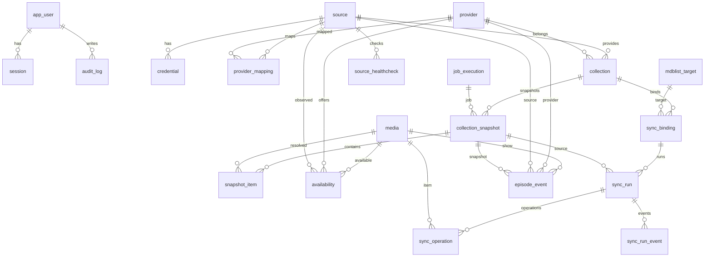

# Fase 1 — Modello dati

**Stato:** progettazione. Il DDL di riferimento è in [`schema.sql`](schema.sql); la migrazione Alembic `0001_initial` di Fase 2 dovrà produrre uno schema equivalente.

---

## 1. Principi

1. **Nessun titolo come chiave.** L'identità di un media è `(media_type, tmdb_id)`; in mancanza, `(media_type, imdb_id)`. Lo stesso ID numerico TMDb può identificare un film e una serie: `media_type` è sempre nella chiave.
2. **Film e serie separati.** `media.media_type ∈ {MOVIE, SHOW}`. Le stagioni/gli episodi non sono `Media`: sono eventi (`episode_event`) collegati alla serie.
3. **Provenienza esplicita.** Ogni collezione ha `origin ∈ {OFFICIAL, AGGREGATOR, CUSTOM}` e `date_basis ∈ {PROVIDER_OFFICIAL, AGGREGATOR_FIRST_SEEN, APP_FIRST_SEEN, UNKNOWN}`.
4. **Snapshot immutabili.** Ogni acquisizione crea un nuovo `collection_snapshot`; solo gli snapshot validi alimentano le sync.
5. **Osservazione vs dichiarazione.** `first_seen_at`/`last_seen_at` sono tempi di osservazione dell'app; `source_date_created` è la data dichiarata dalla fonte (JustWatch `date_created`), se disponibile.
6. **UTC nel database, Europe/Rome nella UI.** Tutti i timestamp sono `TIMESTAMPTZ`; le date `DATE` sono date di calendario della fonte.
7. **Segreti mai in chiaro.** `credential` contiene solo ciphertext, nonce, `key_version` e un hint mascherato.
8. **Concorrenza nel database.** Advisory lock applicativo + unique partial index; nessun lock in memoria.

---

## 2. Diagramma ER

---

## 3. Tabelle

### 3.1 Identità e sicurezza

#### `app_user`
| Colonna | Tipo | Note |
|---|---|---|
| `id` | UUID PK | `gen_random_uuid()` |
| `email` | CITEXT UNIQUE NOT NULL | Login. |
| `password_hash` | TEXT NOT NULL | Argon2id. |
| `is_admin` | BOOLEAN | Single-user: true. |
| `is_active` | BOOLEAN | Disattivazione senza cancellazione. |
| `created_at`, `updated_at`, `last_login_at` | TIMESTAMPTZ | UTC. |

#### `session`
| Colonna | Tipo | Note |
|---|---|---|
| `id` | UUID PK | |
| `user_id` | UUID FK `app_user` | `ON DELETE CASCADE`. |
| `token_hash` | BYTEA UNIQUE | SHA-256 del token opaco; il token in chiaro sta solo nel cookie. |
| `csrf_hash` | BYTEA | Hash del token CSRF. |
| `expires_at`, `last_seen_at`, `revoked_at` | TIMESTAMPTZ | Scadenza, idle, revoca. |
| `ip`, `user_agent` | INET/TEXT | Audit. |

#### `credential`
| Colonna | Tipo | Note |
|---|---|---|
| `id` | UUID PK | |
| `scope` | TEXT | `SOURCE`, `TARGET`, `SYSTEM`. |
| `source_id` | UUID FK `source` NULL | Solo per `SOURCE`. |
| `key` | TEXT | Es. `api_key`, `partner_token`, `s3_secret_key`. |
| `ciphertext`, `nonce` | BYTEA | AES-256-GCM. |
| `key_version` | SMALLINT | Rotazione. |
| `masked_hint` | TEXT | Es. `••••1234`. |
| `last_used_at`, `last_verified_at` | TIMESTAMPTZ | |

Vincolo: `UNIQUE NULLS NOT DISTINCT (scope, source_id, key)`.

### 3.2 Fonti e provider

#### `source`
| Colonna | Tipo | Note |
|---|---|---|
| `id` | UUID PK | |
| `key` | TEXT UNIQUE | `tmdb`, `justwatch_partner`, `justwatch_export`, `manual_csv`. |
| `name` | TEXT | Nome UI. |
| `type` | TEXT | `API`, `DATA_EXPORT`, `MANUAL_CSV`. |
| `base_url` | TEXT | Solo host allowlist. |
| `config` | JSONB | Non segreto: locale, page size, ecc. |
| `capabilities` | JSONB | Capability flags dichiarate. |
| `status` | TEXT | `UNCONFIGURED`, `OK`, `DEGRADED`, `ERROR`, `DISABLED`. |
| `status_message` | TEXT | Messaggio UI. |
| `last_healthcheck_at`, `last_success_at` | TIMESTAMPTZ | |

#### `provider`
| Colonna | Tipo | Note |
|---|---|---|
| `id` | UUID PK | |
| `slug` | TEXT UNIQUE | `netflix`, `prime-video`, ecc. |
| `name` | TEXT | Nome canonico. |
| `logo_url`, `website_url` | TEXT | Display. |

#### `provider_mapping`
| Colonna | Tipo | Note |
|---|---|---|
| `id` | UUID PK | |
| `provider_id` | UUID FK `provider` | |
| `source_id` | UUID FK `source` | |
| `country_code` | CHAR(2) | `IT`. |
| `external_provider_id` | TEXT | ID TMDb/JustWatch. |
| `external_name` | TEXT | Nome nella fonte. |
| `metadata` | JSONB | Display priority, varianti. |

Vincolo: `UNIQUE (source_id, country_code, external_provider_id)`.
**Nota:** i provider ID non vanno hardcodati; si risolvono a ogni sync e si mappano sull'anagrafica canonica. Le varianti "Amazon Channel", "with Ads", "basic" sono mapping separati, non lo stesso provider.

### 3.3 Collezioni

#### `collection`
| Colonna | Tipo | Note |
|---|---|---|
| `id` | UUID PK | |
| `slug` | TEXT UNIQUE | Stabile, leggibile. |
| `source_id` | UUID FK `source` | |
| `provider_id` | UUID FK `provider` | |
| `country_code` | CHAR(2) | Default `IT`. |
| `media_type` | TEXT | `MOVIE`, `SHOW`. |
| `kind` | TEXT | `CATALOG`, `RECENTLY_ADDED`, `UPCOMING`, `CHART`, `CUSTOM_FILTER`. |
| `origin` | TEXT | `OFFICIAL`, `AGGREGATOR`, `CUSTOM`. |
| `date_basis` | TEXT | `PROVIDER_OFFICIAL`, `AGGREGATOR_FIRST_SEEN`, `APP_FIRST_SEEN`, `UNKNOWN`. |
| `name` | TEXT | Etichetta UI. |
| `source_collection_key` | TEXT | Chiave nella fonte (provider slug, genere, chart id). |
| `source_url` | TEXT | URL sorgente, se disponibile. |
| `offer_types` | TEXT[] | Default `{FLATRATE}`. |
| `filters` | JSONB | Genere, anno, ecc. |
| `quality_flags` | JSONB | `partial_pages`, `unverified_provider_mapping`, `added_date_missing`, ecc. |
| `sort_mode` | TEXT | `SOURCE_ORDER`, `POPULARITY`, `TITLE`, `RELEASE_DATE`, `ADDED_DATE`, `CUSTOM`. |
| `is_active` | BOOLEAN | |
| `last_valid_snapshot_id` | UUID FK `collection_snapshot` | Deferrable; punta all'ultimo snapshot valido. |

Vincolo: `UNIQUE (source_id, provider_id, country_code, media_type, kind, source_collection_key)` dove la chiave non è null.

**Regola di etichettatura:**
- `OFFICIAL` richiede una fonte ufficiale verificata e un URL.
- `AGGREGATOR` richiede `source_id` di un aggregatore e un `date_basis` coerente.
- `CUSTOM` è una derivazione dell'app o un filtro utente; non può essere presentata come categoria del provider.

### 3.4 Media e disponibilità

#### `media`
| Colonna | Tipo | Note |
|---|---|---|
| `id` | UUID PK | |
| `media_type` | TEXT | `MOVIE`, `SHOW`. |
| `tmdb_id` | BIGINT | Chiave principale. |
| `imdb_id` | TEXT | Fallback. |
| `tvdb_id`, `trakt_id` | BIGINT | Altri ID. |
| `title`, `original_title` | TEXT | Display, non chiave. |
| `release_year` | SMALLINT | |
| `metadata` | JSONB | Overview, poster, generi, runtime. |
| `resolution_status` | TEXT | `RESOLVED`, `UNRESOLVED`, `AMBIGUOUS`. |
| `not_found_count` | INTEGER | Rifiuti consecutivi di MDBList; dopo 3 il media è soppresso. |
| `sync_suppressed_until` | TIMESTAMPTZ | Riattivabile manualmente. |

Vincoli:
- `UNIQUE (tmdb_id, media_type) WHERE tmdb_id IS NOT NULL`
- `UNIQUE (imdb_id, media_type) WHERE imdb_id IS NOT NULL`
- `CHECK (tmdb_id IS NOT NULL OR imdb_id IS NOT NULL OR tvdb_id IS NOT NULL OR trakt_id IS NOT NULL)`

**Non si crea un `media` senza almeno un ID esterno.** Gli item non risolti restano in `snapshot_item` con `media_id NULL` e `resolution_status='UNRESOLVED'`.

#### `availability`
| Colonna | Tipo | Note |
|---|---|---|
| `id` | UUID PK | |
| `media_id` | UUID FK `media` | |
| `provider_id` | UUID FK `provider` | |
| `country_code` | CHAR(2) | |
| `offer_type` | TEXT | `FLATRATE`, `RENT`, `BUY`, `ADS`, `FREE`. |
| `presentation_type` | TEXT | SD/HD/4K. |
| `channel`, `plan` | TEXT | Canale/piattaforma. |
| `source_id` | UUID FK `source` | |
| `source_offer_id` | TEXT | ID offerta nella fonte. |
| `source_date_created` | DATE | JustWatch `date_created`, se disponibile. |
| `first_seen_at`, `last_seen_at`, `last_checked_at` | TIMESTAMPTZ | Osservazione. |
| `is_active` | BOOLEAN | |
| `metadata` | JSONB | Prezzo, valuta, URL. |

Vincolo: `UNIQUE NULLS NOT DISTINCT (media_id, provider_id, country_code, offer_type, presentation_type, channel, plan, source_id)`.

**Nota:** `first_seen_at` non è la data di aggiunta del provider. È la prima osservazione dell'app. La data dichiarata dalla fonte va in `source_date_created` e va etichettata con `date_basis`.

### 3.5 Snapshot

#### `collection_snapshot`
| Colonna | Tipo | Note |
|---|---|---|
| `id` | UUID PK | |
| `collection_id` | UUID FK `collection` | |
| `status` | TEXT | `RUNNING`, `COMPLETE`, `INCOMPLETE`, `FAILED`, `CANCELLED`. |
| `quality` | TEXT | `CLEAN`, `WARNINGS`, `ANOMALY`. |
| `is_valid` | BOOLEAN | Solo `COMPLETE` + `CLEAN` + item > 0 + 0 errori + 0 unresolved. |
| `started_at`, `finished_at` | TIMESTAMPTZ | |
| `pages_expected`, `pages_fetched` | INTEGER | Completezza. |
| `items_count`, `resolved_count`, `unresolved_count`, `duplicate_count`, `error_count` | INTEGER | Contatori. |
| `errors`, `warnings` | JSONB | Dettagli. |
| `source_revision` | TEXT | ETag/last-modified/dump date. |
| `checksum` | TEXT | SHA-256 degli ID normalizzati. |
| `job_execution_id` | UUID FK `job_execution` | |

Vincoli:
- `CHECK (NOT is_valid OR (status='COMPLETE' AND quality='CLEAN' AND items_count > 0 AND error_count = 0 AND unresolved_count = 0))`
- `UNIQUE (collection_id) WHERE status='RUNNING'` — un solo snapshot in corso per collezione.

**Regola:** uno snapshot `COMPLETE` con `quality='WARNINGS'` può essere usato per APPEND_ONLY, ma non per MIRROR. `is_valid=false` non significa "dati inutili": significa "non autorizza rimozioni".

#### `snapshot_item`
| Colonna | Tipo | Note |
|---|---|---|
| `id` | UUID PK | |
| `snapshot_id` | UUID FK `collection_snapshot` | `ON DELETE CASCADE`. |
| `media_id` | UUID FK `media` NULL | NULL se non risolto. |
| `position` | INTEGER | Ordine nella fonte. |
| `source_item_id` | TEXT | ID nella fonte. |
| `source_payload` | JSONB | Payload normalizzato/anonimizzato. |
| `source_date_created` | DATE | |
| `date_basis` | TEXT | |
| `resolution_status` | TEXT | `RESOLVED`, `UNRESOLVED`, `AMBIGUOUS`. |
| `resolution_error` | TEXT | |

Vincoli:
- `UNIQUE (snapshot_id, position)`
- `UNIQUE (snapshot_id, media_id) WHERE media_id IS NOT NULL` — dedup.

### 3.6 Target MDBList e sync

#### `mdblist_target`
| Colonna | Tipo | Note |
|---|---|---|
| `id` | UUID PK | |
| `remote_list_id` | BIGINT UNIQUE | **Chiave stabile.** |
| `remote_slug` | TEXT | Display; può cambiare. |
| `remote_url` | TEXT | Display. |
| `name` | TEXT | |
| `mediatype` | TEXT | `MOVIE`, `SHOW`, `SEASON`, `EPISODE`. |
| `is_private` | BOOLEAN | |
| `item_count` | INTEGER | Letto dalla lista. |
| `last_verified_at`, `last_remote_read_at` | TIMESTAMPTZ | |
| `capabilities` | JSONB | `supports_reorder`, `max_reorder_batch`, ecc. |

#### `sync_binding`
| Colonna | Tipo | Note |
|---|---|---|
| `id` | UUID PK | |
| `collection_id` | UUID FK `collection` | |
| `target_id` | UUID FK `mdblist_target` | |
| `mode` | TEXT | `MIRROR`, `APPEND_ONLY`. |
| `schedule_cron` | TEXT | Es. `0 6 * * *`. |
| `timezone` | TEXT | Default `Europe/Rome`. |
| `is_enabled` | BOOLEAN | |
| `policy_version`, `policy_accepted_at`, `policy_accepted_by` | TEXT/TIMESTAMPTZ/UUID | Conferma esplicita. |
| `max_removal_absolute` | INTEGER | Default 50. |
| `max_removal_percent` | NUMERIC(5,2) | Default 10.00. |
| `max_addition_percent` | NUMERIC(5,2) | Default 50.00. |
| `preserve_order` | BOOLEAN | Default false. |
| `reorder_enabled` | BOOLEAN | Default true; disattivabile per liste grandi/fragili. |
| `require_manual_review` | BOOLEAN | Default true. |
| `schedule_policy` | TEXT | `AUTO_APPLY_IF_SAFE`, `ALWAYS_APPROVE`, `DRY_RUN_ONLY`. |
| `auto_apply_max_removals` | INTEGER | Default 5. |
| `auto_apply_max_removal_ratio` | NUMERIC(5,2) | Default 2.00%. |
| `max_plan_age_minutes` | INTEGER | Default 60; oltre, la conferma scade. |
| `last_run_id` | UUID FK `sync_run` | Deferrable. |
| `next_run_at` | TIMESTAMPTZ | Calcolato dallo scheduler. |

Vincoli:
- `UNIQUE (collection_id, target_id)`
- `UNIQUE (target_id) WHERE is_enabled = true` — un solo writer attivo per target.
- `CHECK (NOT is_enabled OR (policy_accepted_at IS NOT NULL AND policy_version IS NOT NULL))`
- `media_type` + FK composita `(collection_id, media_type) → collection(id, media_type)` e `(target_id, media_type) → mdblist_target(id, mediatype)`: un binding non può collegare una collezione film a una lista serie.

**Separazione film/serie a livello DB:** `collection` e `mdblist_target` hanno `UNIQUE (id, media_type)`; `sync_binding` e `sync_run` portano `media_type` e FK composite. `episode_event` ha `media_type='SHOW'` e FK composita a `media(id, media_type)`. Questo impedisce di mescolare film e serie anche con una scrittura manuale.

#### `sync_run`
| Colonna | Tipo | Note |
|---|---|---|
| `id` | UUID PK | |
| `binding_id` | UUID FK `sync_binding` | |
| `target_id` | UUID FK `mdblist_target` | Denormalizzato per il lock/unique per target. |
| `media_type` | TEXT | Coerente con binding e target. |
| `snapshot_id` | UUID FK `collection_snapshot` | |
| `mode` | TEXT | |
| `status` | TEXT | `PENDING`, `PREFLIGHT`, `PLANNING`, `AWAITING_APPROVAL`, `APPLYING`, `VERIFYING`, `SUCCEEDED`, `PARTIAL`, `FAILED`, `BLOCKED`, `CANCELLED`. |
| `is_dry_run` | BOOLEAN | |
| `trigger` | TEXT | `MANUAL`, `SCHEDULED`, `RETRY`. |
| `plan_hash`, `snapshot_hash` | TEXT | Conferma legata al piano visto. |
| `order_enforced` | BOOLEAN | False se reorder disabilitato/fallito. |
| `warnings` | JSONB | Es. `ORDER_NOT_ENFORCED`. |
| `parent_run_id` | UUID FK `sync_run` | Ripresa da un run precedente. |
| `not_before` | TIMESTAMPTZ | Attesa per rate limit/finestra. |
| `abort_reason` | TEXT | `LOCK_HELD`, `NO_ACCESS`, `SNAPSHOT_EMPTY`, ecc. |
| `threshold_breached`, `requires_approval`, `approved_at`, `approved_by` | BOOL/TIMESTAMPTZ/UUID | Revisione manuale. |
| `started_at`, `finished_at` | TIMESTAMPTZ | |
| `source_item_count`, `remote_item_count` | INTEGER | |
| `to_add_count`, `to_remove_count` | INTEGER | Piano. |
| `added_count`, `removed_count`, `failed_count`, `uncertain_count` | INTEGER | Esecuzione. |
| `error_code`, `error_message` | TEXT | |
| `summary` | JSONB | Dettagli UI. |
| `lock_key` | TEXT | Audit del lock. |
| `requested_by` | UUID FK `app_user` | |

Vincolo: `UNIQUE (binding_id) WHERE status IN ('PENDING','PREFLIGHT','PLANNING','AWAITING_APPROVAL','APPLYING','VERIFYING')` — un solo run attivo per binding.

#### `sync_operation`
| Colonna | Tipo | Note |
|---|---|---|
| `id` | UUID PK | |
| `run_id` | UUID FK `sync_run` | `ON DELETE CASCADE`. |
| `batch_id` | UUID | Raggruppa le operazioni inviate insieme. |
| `action` | TEXT | `ADD`, `REMOVE`, `REORDER`. |
| `media_id` | UUID FK `media` NULL | NULL per REORDER di chunk. |
| `remote_id` | TEXT | ID usato verso MDBList. |
| `idempotency_key` | TEXT UNIQUE | `sha256(run_id|action|media_type|tmdb_id|target_id)`. |
| `status` | TEXT | `PENDING`, `IN_FLIGHT`, `SUCCEEDED`, `FAILED`, `UNCERTAIN`, `SKIPPED`. |
| `attempt`, `max_attempts` | INTEGER | Default max 5. |
| `next_retry_at`, `reconciled_at` | TIMESTAMPTZ | Retry e riconciliazione. |
| `http_status`, `duration_ms` | INTEGER | Audit. |
| `request_hash` | TEXT | |
| `response` | JSONB | Risposta remota redatta. |
| `error_code`, `error_message` | TEXT | |
| `started_at`, `finished_at` | TIMESTAMPTZ | |

Vincoli:
- `UNIQUE (run_id, action, media_id)` — evita duplicati nello stesso run. Per REORDER, `media_id` è NULL e più righe sono ammesse (NULL distinct).
- `idempotency_key` unico globalmente.

#### `sync_run_event`
Audit leggero delle transizioni di stato: `run_id`, `from_status`, `to_status`, `message`, `created_at`. Alimenta la timeline UI.

### 3.7 Eventi stagioni/episodi

#### `episode_event`
| Colonna | Tipo | Note |
|---|---|---|
| `id` | UUID PK | |
| `show_media_id` | UUID FK `media` | La serie, non l'episodio. |
| `provider_id` | UUID FK `provider` | |
| `country_code` | CHAR(2) | |
| `source_id` | UUID FK `source` | |
| `snapshot_id` | UUID FK `collection_snapshot` NULL | |
| `event_type` | TEXT | `SEASON_ADDED`, `SEASON_REMOVED`, `EPISODE_ADDED`, `EPISODE_REMOVED`. |
| `season_number` | INTEGER | |
| `episode_number` | INTEGER NULL | |
| `occurred_at` | TIMESTAMPTZ | |
| `source_payload` | JSONB | |

Vincolo: `UNIQUE NULLS NOT DISTINCT (show_media_id, provider_id, country_code, source_id, event_type, season_number, episode_number)`.

**Regola:** un nuovo episodio non crea un nuovo `media`; crea un `episode_event` e, se il target lo supporta, può essere aggiunto come `episode` a MDBList. Di default le liste restano a livello serie.

### 3.8 Job, audit, healthcheck

#### `job_execution`
Stato persistente dei task Celery: `task_id` unico, `task_name`, `queue`, `status`, `payload`, `result`, `error_code`, `error_message`, timestamp. Serve alla dashboard e al debug; non sostituisce `sync_run`.

#### `audit_log`
`actor_user_id`, `actor_type`, `action`, `entity_type`, `entity_id`, `before`, `after`, `ip`, `user_agent`, `request_id`, `created_at`. I campi `before`/`after` sono redatti: mai segreti.

#### `source_healthcheck`
`source_id`, `status`, `latency_ms`, `message`, `details`, `checked_at`. Storico per la dashboard.

---

## 4. Enum e valori

| Dominio | Valori |
|---|---|
| `media_type` | `MOVIE`, `SHOW` |
| `collection.kind` | `CATALOG`, `RECENTLY_ADDED`, `UPCOMING`, `CHART`, `CUSTOM_FILTER` |
| `collection.origin` | `OFFICIAL`, `AGGREGATOR`, `CUSTOM` |
| `date_basis` | `PROVIDER_OFFICIAL`, `AGGREGATOR_FIRST_SEEN`, `APP_FIRST_SEEN`, `UNKNOWN` |
| `offer_type` | `FLATRATE`, `RENT`, `BUY`, `ADS`, `FREE` |
| `snapshot.status` | `RUNNING`, `COMPLETE`, `INCOMPLETE`, `FAILED`, `CANCELLED` |
| `snapshot.quality` | `CLEAN`, `WARNINGS`, `ANOMALY` |
| `sync_binding.mode` | `MIRROR`, `APPEND_ONLY` |
| `sync_run.status` | `PENDING`, `PREFLIGHT`, `PLANNING`, `AWAITING_APPROVAL`, `APPLYING`, `VERIFYING`, `SUCCEEDED`, `PARTIAL`, `FAILED`, `BLOCKED`, `CANCELLED` |
| `sync_operation.action` | `ADD`, `REMOVE`, `REORDER` |
| `sync_operation.status` | `PENDING`, `IN_FLIGHT`, `SUCCEEDED`, `FAILED`, `UNCERTAIN`, `SKIPPED` |
| `source.status` | `UNCONFIGURED`, `OK`, `DEGRADED`, `ERROR`, `DISABLED` |
| `source.type` | `API`, `DATA_EXPORT`, `MANUAL_CSV` |
| `credential.scope` | `SOURCE`, `TARGET`, `SYSTEM` |
| `episode_event.event_type` | `SEASON_ADDED`, `SEASON_REMOVED`, `EPISODE_ADDED`, `EPISODE_REMOVED` |

---

## 5. Trigger e guardie di integrità

Il DDL include trigger che rendono impossibili alcuni errori a livello di database:

| Trigger | Regola |
|---|---|
| `collection_origin_guard` | `OFFICIAL` richiede `source.is_official = true`; `AGGREGATOR` richiede `source.origin_default = 'AGGREGATOR'`. |
| `sync_run_snapshot_guard` | Lo snapshot deve appartenere alla stessa collezione, il target e il `media_type` devono coincidere con il binding, `mode` deve coincidere, lo snapshot non può essere `RUNNING`; MIRROR richiede `is_valid`, APPEND_ONLY richiede `COMPLETE` e `items_count > 0`. |
| `sync_operation_media_type_guard` | Un'operazione ADD/REMOVE deve riferirsi a un media dello stesso `media_type` del run. |
| `audit_log_append_only` | `UPDATE`/`DELETE` su `audit_log` falliscono. |
| `*_touch` | Aggiorna `updated_at` su ogni `UPDATE`. |

Queste guardie non sostituiscono la validazione applicativa: sono la seconda barriera contro bug e scritture manuali.

## 6. Indici e concorrenza

| Indice | Scopo |
|---|---|
| `media_tmdb_uq`, `media_imdb_uq` | Identità e dedup. |
| `snapshot_one_running_uq` | Un solo snapshot RUNNING per collezione. |
| `snapshot_item_media_uq` | Dedup nello snapshot. |
| `binding_one_active_target_uq` | Un solo binding attivo per target. |
| `binding_due_idx` | Query dello scheduler. |
| `run_one_active_binding_uq` | Un solo run attivo per binding. |
| `sync_operation.idempotency_key` | Idempotenza locale. |
| `availability` unique nulls not distinct | Evita duplicati di disponibilità. |
| `episode_event` unique nulls not distinct | Evita duplicati di eventi. |
| `credential` unique nulls not distinct | Una credenziale per scope/source/key. |

**Advisory lock:** `pg_try_advisory_lock(hashtext('target:' || target_id))` nel worker. L'indice unique è la seconda barriera; il lock è la prima.

---

## 7. Ordine delle migrazioni Alembic

| Revisione | Contenuto |
|---|---|
| `0001_extensions` | `pgcrypto`, `citext`. |
| `0002_identity` | `app_user`, `session`, `app_setting`. |
| `0003_sources` | `source`, `credential`, `provider`, `provider_mapping`. |
| `0004_media` | `media`, `availability`. |
| `0005_collections` | `collection`, `job_execution`. |
| `0006_snapshots` | `collection_snapshot`, `snapshot_item`, FK differita `collection.last_valid_snapshot_id`. |
| `0007_mdblist` | `mdblist_target`, `sync_binding`. |
| `0008_sync` | `sync_run`, `sync_operation`, `sync_run_event`, FK differita `sync_binding.last_run_id`. |
| `0009_episodes` | `episode_event`. |
| `0010_audit` | `audit_log`, `source_healthcheck`. |
| `0011_indexes` | Indici e unique partial non creati inline. |

Regole: una sola head; `downgrade()` testato; `alembic check` in CI; nessuna modifica a revisioni rilasciate.

---

## 8. Retention

| Dato | Retention default | Note |
|---|---|---|
| `collection_snapshot` + `snapshot_item` | 90 giorni | Mantieni l'ultimo valido per collezione anche se più vecchio. |
| `sync_run` + `sync_operation` | 180 giorni | I run `PARTIAL`/`FAILED` recenti non vanno cancellati. |
| `sync_run_event` | 180 giorni | |
| `audit_log` | 180 giorni | Non cancellare eventi di sicurezza recenti. |
| `source_healthcheck` | 30 giorni | |
| `job_execution` | 30 giorni | |
| `session` scadute | 7 giorni dopo `expires_at` | |
| `credential` | Fino a revoca | Mai cancellare senza audit. |

La retention è un task `maintenance` idempotente; non deve mai cancellare l'ultimo snapshot valido o un run non terminale.

---

## 9. Regole di qualità dei dati

1. **Snapshot valido** = `COMPLETE` + `CLEAN` + `items_count > 0` + `error_count = 0` + `unresolved_count = 0`.
2. **Snapshot con warning** = `COMPLETE` + `WARNINGS`; può alimentare APPEND_ONLY, non MIRROR.
3. **Snapshot anomalo** = `COMPLETE` ma con variazione oltre soglia o catalogo vuoto; `is_valid=false`, `ANOMALY`.
4. **Elemento non risolto** = nessun `tmdb_id`/`imdb_id`; resta in `snapshot_item` con `media_id NULL`; non entra nel piano MIRROR.
5. **Duplicato** = stessa chiave `(media_type, tmdb_id)` nella stessa pagina; tiene la prima occorrenza e incrementa `duplicate_count`.
6. **Conflitto** = stesso `tmdb_id` con titoli/anni incompatibili; `AMBIGUOUS`, richiede revisione.
7. **Data** = `source_date_created` solo se la fonte la dichiara; `first_seen_at` è sempre dell'app; `date_basis` dice quale delle due stai guardando.

---

## 10. Cosa non viene memorizzato

- Nessun titolo come chiave di deduplicazione.
- Nessun episodio come `media` separato: solo `episode_event`.
- Nessun segreto in chiaro.
- Nessun payload di fonte non necessario: si conserva il minimo per audit e debug, redatto.
- Nessuna lista MDBList duplicata per simulare l'ordine.
- Nessuna categoria "ufficiale" senza fonte verificata.
