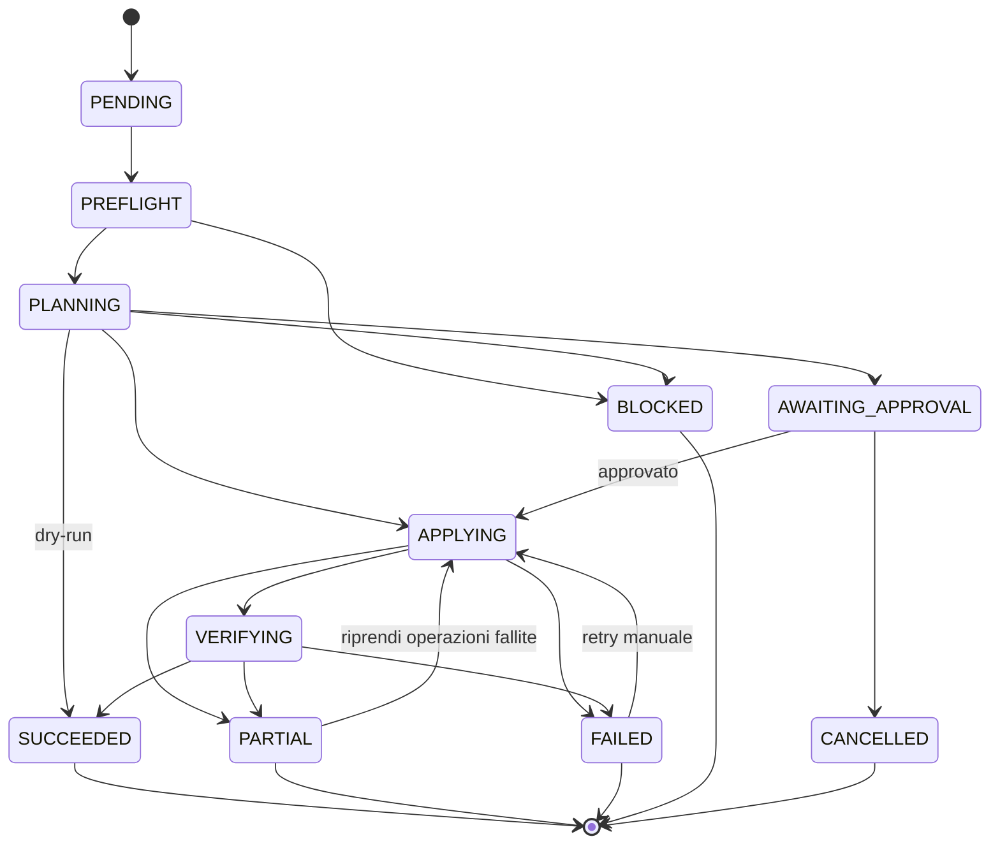
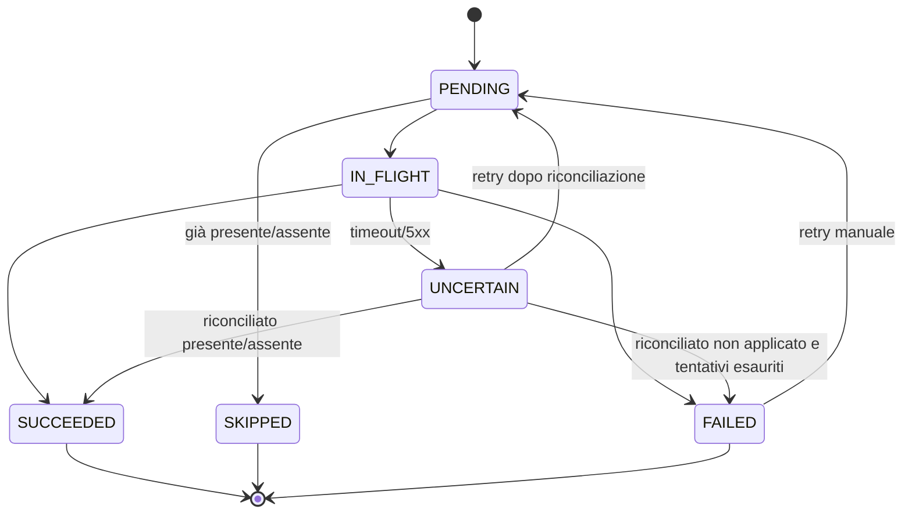

# Fase 1 — Motore di sincronizzazione

**Stato:** progettazione. Nessuna sync reale eseguita.
**Riferimenti:** [`02-mdblist-api.md`](02-mdblist-api.md), [`04-data-model.md`](04-data-model.md), [`schema.sql`](schema.sql).

---

## 1. Principi

1. **Nessuna scrittura senza piano.** Ogni run produce un piano `to_add`/`to_remove`/`to_keep`; il dry-run è sempre disponibile.
2. **Nessuna rimozione da dati incompleti.** Snapshot non valido, vuoto o anomalo → `BLOCKED`.
3. **Nessuna transazione distribuita.** Ogni modifica remota è una `SyncOperation` persistita; lo stato incerto si riconcilia leggendo il remoto.
4. **Un solo writer per target.** Advisory lock PostgreSQL + unique partial index.
5. **Nessun retry cieco.** Dopo un timeout, si legge lo stato remoto prima di ritentare.
6. **Ordine best-effort.** Il reorder MDBList è opzionale, max 1.000 elementi per chiamata, non atomico; non si ricrea la lista.
7. **Tutto tracciato.** Run, operazioni, transizioni di stato, errori e contatori sono nel DB e visibili in UI.

---

## 2. Stati

### 2.1 `SyncRun`



| Stato | Significato | Scritture remote |
|---|---|---|
| `PENDING` | Run creato, in coda. | No |
| `PREFLIGHT` | Verifica credenziali, target, snapshot, lock. | No |
| `PLANNING` | Lettura remota e calcolo del piano. | No |
| `AWAITING_APPROVAL` | Soglie superate o revisione richiesta. | No |
| `APPLYING` | Add/remove in batch. | Sì |
| `VERIFYING` | Rilettura e riconciliazione. | No (solo letture) |
| `SUCCEEDED` | Contenuto e ordine (se richiesto) allineati. | — |
| `PARTIAL` | Alcune operazioni fallite/incerte; contenuto parziale. | — |
| `FAILED` | Errore fatale, nessuna operazione riuscita o auth/permessi. | — |
| `BLOCKED` | Policy: snapshot invalido/vuoto, soglie, target non scrivibile. | No |
| `CANCELLED` | Annullato prima dell'applicazione. | No |

### 2.2 `SyncOperation`



| Stato | Significato |
|---|---|
| `PENDING` | Operazione pianificata, non inviata. |
| `IN_FLIGHT` | Richiesta inviata, risposta non ancora registrata. |
| `SUCCEEDED` | Verificata sul remoto. |
| `FAILED` | Errore definitivo o tentativi esauriti. |
| `UNCERTAIN` | Timeout/5xx dopo l'invio: esito remoto ignoto. |
| `SKIPPED` | Già presente (ADD) o già assente (REMOVE). |

---

## 3. Preflight

```python
async def preflight(run_id: UUID) -> PreflightResult:
    run = await runs.get(run_id)
    binding = await bindings.get(run.binding_id)
    target = await targets.get(binding.target_id)
    snapshot = await snapshots.get(run.snapshot_id)

    # 1. Credenziale MDBList
    credential = await credentials.get_target("MDBLIST")
    if not credential:
        return block("MDBLIST_AUTH_MISSING")

    # 2. Target leggibile e proprietario
    remote = await mdblist.get_list(target.remote_list_id)
    if remote.user_id != credential.user_id:
        return block("MDBLIST_PERMISSION_DENIED")

    # 3. Snapshot utilizzabile
    if snapshot.status != "COMPLETE":
        return block("SNAPSHOT_INCOMPLETE")
    if snapshot.items_count == 0:
        return block("SNAPSHOT_EMPTY")
    if run.mode == "MIRROR" and not snapshot.is_valid:
        return block("SNAPSHOT_NOT_VALID_FOR_MIRROR")
    if run.mode == "MIRROR" and snapshot.unresolved_count > 0:
        return block("SNAPSHOT_UNRESOLVED_ITEMS")

    # 4. Lock per target
    if not await locks.try_target(target.id):
        return block("SYNC_ALREADY_RUNNING")

    # 5. Policy
    if binding.is_enabled and binding.policy_accepted_at is None:
        return block("POLICY_NOT_ACCEPTED")

    return PreflightResult(ok=True, remote=remote)
```

**Regole:**
- Il preflight non scrive nulla sul remoto.
- Se la lista remota non è leggibile completamente, il run è `BLOCKED`.
- Se il target è una lista dinamica o non posseduta, add/remove/reorder possono restituire `403`: trattare come blocco definitivo.
- Il lock va rilasciato in `finally`, anche in caso di eccezione.

---

## 4. Piano

### 4.1 Normalizzazione delle chiavi

```python
def media_key(media_type: str, tmdb_id: int | None, imdb_id: str | None) -> tuple[str, str] | None:
    if tmdb_id is not None:
        return (media_type, f"tmdb:{tmdb_id}")
    if imdb_id is not None:
        return (media_type, f"imdb:{imdb_id}")
    return None
```

- `media_type` sempre presente: un film e una serie con lo stesso ID numerico sono entità diverse.
- Gli item non risolti non entrano nel piano; vengono contati e mostrati.
- I duplicati nella sorgente vengono collassati prima del diff.

### 4.2 MIRROR

```python
source_keys = {media_key(i) for i in snapshot.resolved_items}
remote_keys = {media_key(i) for i in remote_items}

to_add = source_keys - remote_keys
to_remove = remote_keys - source_keys
to_keep = source_keys & remote_keys
```

- `to_remove` è calcolato **solo** se lo snapshot è valido e non vuoto.
- Se `to_remove` supera le soglie, il run va in `AWAITING_APPROVAL`.
- Se la lista remota contiene elementi non risolvibili (senza TMDB/IMDb), non rimuoverli automaticamente: vanno in `unmapped_remote` e richiedono revisione.
- Se la lista remota contiene duplicati dello stesso `MediaKey`, non rimuoverli: `remove` potrebbe cancellare tutte le occorrenze. Vanno in `remote_duplicates` e sono mostrati in UI.
- Gli elementi locali non risolti (`unresolved`) non entrano in `to_remove`: non esistono remotamente, quindi non devono causare rimozioni.

### 4.3 APPEND_ONLY

```python
to_add = source_keys - remote_keys
to_remove = set()
```

- Nessuna rimozione, mai.
- Se un elemento è già presente, `SKIPPED`.
- Se lo snapshot è `COMPLETE` con `WARNINGS`, le aggiunte risolte sono ammesse; gli unresolved vengono saltati.

### 4.4 Dry-run e `plan_hash`

- Crea un `SyncRun` con `is_dry_run=true`.
- Esegue preflight, lettura remota e piano.
- Non crea `SyncOperation` con stato `IN_FLIGHT`; può crearle in `PENDING` per mostrare il dettaglio, ma non le invia.
- Stato finale `SUCCEEDED` (piano pronto) o `BLOCKED` (policy).
- Il dry-run è sempre disponibile, anche per binding disabilitati.
- Il piano produce un `plan_hash = sha256(mode | snapshot_hash | sorted(to_add) | sorted(to_remove) | rank_target_digest | policy_version)`. La conferma manuale è legata a `plan_hash` + `snapshot_hash`: se il piano cambia o scade (`max_plan_age_minutes`, default 60), la conferma restituisce `409` e va rifatta.
- Il `snapshot_hash` è lo SHA-256 degli ID normalizzati dello snapshot usato.

---

## 5. Soglie di sicurezza

Configurazione per binding:

| Soglia | Default | Significato |
|---|---|---|
| `max_removal_absolute` | 50 | Numero massimo di rimozioni in un run. |
| `max_removal_percent` | 10% | Percentuale massima di rimozioni rispetto al remoto. |
| `max_addition_percent` | 50% | Percentuale massima di aggiunte rispetto al remoto. |
| `require_manual_review` | true | Se una soglia è superata, richiede approvazione. |

Calcolo:

```python
def evaluate_thresholds(plan, remote_count, binding) -> ThresholdResult:
    if remote_count == 0:
        # Lista vuota: aggiunte illimitate? No, applica la soglia sulle aggiunte
        # rispetto allo snapshot, non al remoto.
        addition_ratio = 1.0 if plan.to_add else 0.0
    else:
        addition_ratio = len(plan.to_add) / remote_count

    removal_ratio = len(plan.to_remove) / max(remote_count, 1)

    blocked = (
        len(plan.to_remove) > binding.max_removal_absolute
        or removal_ratio > binding.max_removal_percent / 100
        or addition_ratio > binding.max_addition_percent / 100
    )
    return ThresholdResult(blocked=blocked, ...)
```

**Regole:**
- Snapshot vuoto → `BLOCKED`, non "rimuovi tutto".
- Snapshot incompleto → `BLOCKED`, nessuna rimozione.
- Snapshot con unresolved > 0 → MIRROR `BLOCKED`; APPEND_ONLY può procedere con warning.
- Variazione anomala (es. rimozioni > 50% o aggiunte > 100%) → `AWAITING_APPROVAL`.
- Le soglie non si applicano al dry-run: il dry-run mostra il piano e segnala il blocco.

---

## 6. Esecuzione

### 6.1 Ordine di applicazione

L'ordine è **ADD → REMOVE → REORDER**:

1. aggiungere gli elementi mancanti;
2. rimuovere quelli in eccesso;
3. applicare il reorder, se richiesto.

Un fallimento a metà non deve mai lasciare la lista priva di elementi desiderati: il costo è una finestra temporanea di sovrainsieme, non distruttiva. L'ordine inverso (remove prima) potrebbe lasciare la lista incompleta se il processo si interrompe.

### 6.2 Creazione delle operazioni

```python
for key in plan.to_remove:
    operations.add(SyncOperation(
        run_id=run.id,
        action="REMOVE",
        media_id=media_id(key),
        idempotency_key=sha256(f"{run.id}|REMOVE|{key}|{target.id}"),
        status="PENDING",
    ))

for key in plan.to_add:
    operations.add(SyncOperation(
        run_id=run.id,
        action="ADD",
        media_id=media_id(key),
        idempotency_key=sha256(f"{run.id}|ADD|{key}|{target.id}"),
        status="PENDING",
    ))
```

- Le operazioni vengono create **prima** dell'invio, in una transazione DB.
- `idempotency_key` unico evita duplicati nello stesso run.
- `batch_id` raggruppa le operazioni inviate nella stessa richiesta.

### 6.3 Batch

- Dimensione batch configurabile (default 100).
- Budget scritture: 300/5 min; il client usa un token bucket Redis con margine (es. 240/5 min).
- Ordine: **ADD → REMOVE → REORDER**. Aggiungere prima evita una finestra in cui mancano elementi desiderati; il costo è un temporaneo sovrainsieme. Se la lista è vicina al limite massimo, ridurre il batch o concordare una strategia specifica, ma non rimuovere prima di aver verificato gli `ADD`.
- Dopo ogni batch:
  - `200` con contatori → marca le operazioni `SUCCEEDED`/`SKIPPED` in base a `added`/`existing`/`not_found`; per `not_found` marca `FAILED` con `MDBLIST_NOT_FOUND`.
  - `429` → rispetta `Retry-After`, non marcare nulla, riprova il batch.
  - `5xx`/timeout → marca le operazioni del batch `UNCERTAIN`, non ritentare subito.
  - `401`/`403`/`404` → `FAILED`/`BLOCKED`, stop.

### 6.4 Riconciliazione

Dopo l'applicazione (e dopo ogni batch incerto):

```python
async def reconcile(run_id: UUID):
    remote = await read_all_remote_items(target)
    remote_keys = {media_key(i) for i in remote}

    for op in operations.pending_or_uncertain(run_id):
        present = op.media_key in remote_keys
        if op.action == "ADD" and present:
            op.mark_succeeded()
        elif op.action == "REMOVE" and not present:
            op.mark_succeeded()
        elif op.attempt < max_attempts:
            op.mark_pending_for_retry()
        else:
            op.mark_failed("MDBLIST_UNCERTAIN")
```

- La lettura remota usa `cursor` + `X-Has-More`; se è incompleta, non si conclude nulla.
- La riconciliazione è la fonte di verità, non i contatori aggregati.
- Se la lista cambia durante la lettura (modifica manuale), il run va in `PARTIAL` e richiede revisione.

### 6.5 Retry

```python
def next_delay(attempt: int, retry_after: int | None) -> float:
    if retry_after is not None:
        return retry_after
    base = 0.5 * (2 ** attempt)
    cap = 30.0
    jitter = random.uniform(0.8, 1.2)
    return min(base, cap) * jitter
```

- Max 5 tentativi per operazione.
- `Retry-After` ha precedenza.
- Non retryable: `400`, `401`, `403`, `404`, schema cambiato, policy.
- Dopo un timeout: `UNCERTAIN` → riconciliazione → retry solo se l'operazione non è stata applicata.

### 6.6 Ordine (reorder)

- `preserve_order` default `false`.
- Se `true` e il target è una lista statica:
  1. attendere che add/remove siano riconciliati;
  2. leggere l'ordine corrente (`sort=usort`);
  3. costruire la sequenza desiderata dallo snapshot;
  4. se la lista ≤ 1.000 elementi: una chiamata `POST /lists/{id}/items/reorder` con tutti gli elementi nell'ordine;
  5. se > 1.000: chunk da 1.000; il primo chunk con `position=top`, i successivi con `after` = ultimo elemento del chunk precedente;
  6. rileggere `sort=usort` e verificare l'ordine;
  7. se il reorder fallisce: il run resta `SUCCEEDED` con warning `ORDER_NOT_ENFORCED` e `order_enforced=false`; il contenuto è corretto, l'ordine no. Non è un `PARTIAL`, perché non mancano elementi.
- Non cancellare e ricreare la lista.
- L'UI mostra "ordine best-effort; liste >1.000 elementi possono richiedere più passaggi e un'interruzione lascia l'ordine parziale".
- Se `reorder_enabled=false`, il run dichiara `order_enforced=false` fin dall'inizio.

### 6.7 Successi parziali

- `PARTIAL` se almeno un'operazione è `SUCCEEDED` e almeno una è `FAILED`/`UNCERTAIN`.
- Il run espone i contatori e l'elenco operazioni.
- "Riprendi" crea un nuovo run con `parent_run_id`, rilegge lo snapshot e ricalcola il piano: non riusa il piano vecchio, perché la lista può essere cambiata a mano.
- Non si nasconde un fallimento parziale come successo.
- `not_found` (ID non riconosciuto da MDBList) viene registrato per media; dopo N rifiuti consecutivi (default 3) il media è soppresso dai piani successivi, con possibilità di riattivarlo manualmente.

---

## 7. Concorrenza e idempotenza

### 7.1 Lock

```python
async def try_target_lock(conn, target_id: UUID) -> bool:
    key = f"mdblist_target:{target_id}"
    return await conn.scalar(
        "SELECT pg_try_advisory_lock(hashtextextended(:key, 0))", {"key": key}
    )
```

- Il lock è **di sessione**, non transazionale: il run attraversa più transazioni (piano, batch, riconciliazione). `pg_advisory_xact_lock` non basta.
- Il lock è per `target_id`, non per binding: due binding sullo stesso target non possono scrivere insieme.
- La connessione che tiene il lock resta aperta per tutto il run; il lock va rilasciato in `finally`.
- In caso di contesa, il run non attende: `FAILED(LOCK_HELD)` o riaccodato al tick successivo.

### 7.2 Unique partial index

- `sync_binding (target_id) WHERE is_enabled = true` → un solo binding attivo per target.
- `sync_run (binding_id) WHERE status IN (...)` → un solo run attivo per binding.
- `collection_snapshot (collection_id) WHERE status = 'RUNNING'` → una sola acquisizione per collezione.

### 7.3 Idempotenza

- `idempotency_key` unico per operazione.
- `task_id` deterministico per il task Celery.
- La creazione del run è idempotente rispetto a `binding_id` + slot temporale: lo scheduler usa `last_enqueued_slot`/`next_run_at` per non duplicare.
- Dopo un crash, il run resta `RUNNING`/`APPLYING`; uno sweep lo porta a `VERIFYING` e riconcilia.

---

## 8. Conferma e policy

- Alla creazione di un binding su una lista **esistente**, l'UI mostra:
  - numero di elementi remoti;
  - elementi che MIRROR rimuoverebbe;
  - avviso che anche gli elementi aggiunti manualmente saranno rimossi;
  - checkbox di conferma esplicita.
- `policy_accepted_at` e `policy_version` vengono salvati sul binding.
- Le sync pianificate non chiedono conferma a ogni run: l'utente ha autorizzato la policy abilitando il binding.
- `schedule_policy`:
  - `AUTO_APPLY_IF_SAFE` (default): applica solo se non ci sono blocker, nessuna soglia superata e `to_remove == 0` oppure rimozioni entro i tetti di auto-apply;
  - `ALWAYS_APPROVE`: ogni run pianificato richiede approvazione;
  - `DRY_RUN_ONLY`: il run pianificato produce solo il piano.
- Se una soglia viene superata, il run si ferma in `AWAITING_APPROVAL` e richiede una conferma manuale legata a `plan_hash`.
- Un binding disabilitato non esegue sync pianificate; il dry-run manuale resta disponibile.

---

## 9. Cosa dipende da capacità MDBList non verificate

| Capacità | Stato | Impatto |
|---|---|---|
| `POST /lists/{listid}/items/reorder` | **VERIFICATO** nello schema live; max 1.000 per chiamata | Reorder opzionale, non atomico. |
| Limite elementi per add/remove | **NON VERIFICATO** | Batch conservativi (100), misurare con API key. |
| Posizione di inserimento di `add` | **NON VERIFICATO** | Non assumere testa/coda; leggere `rank`/`usort`. |
| Semantica di `existing`/`not_found` | **PARZIALMENTE VERIFICATO** | Riconciliare con lettura completa. |
| Stabilità dello slug dopo rinomina | **NON VERIFICATO** | Usare `remote_list_id`; rileggere slug/URL. |
| Tipo statico vs dinamico | **NON VERIFICATO** | Conferma esplicita + preflight; `403` = blocco. |
| Idempotency key lato API | **NON DOCUMENTATO** | Solo idempotenza locale + riconciliazione. |
| Atomicità add/remove/reorder | **NON DOCUMENTATA** | Operation ledger + `PARTIAL` per add/remove; warning `ORDER_NOT_ENFORCED` per il reorder. |

---

## 10. Test da implementare

### Unit
- `test_mirror_plan.py`: `to_add`/`to_remove` con duplicati, unresolved, lista vuota.
- `test_append_only.py`: nessuna rimozione, anche con differenze.
- `test_thresholds.py`: soglie assolute/percentuali, lista vuota, variazione anomala.
- `test_media_key.py`: film vs serie con lo stesso ID; IMDb fallback; unresolved.
- `test_retry_policy.py`: 429/Retry-After, 5xx, 4xx non retryable, jitter.
- `test_uncertain_outcome.py`: timeout → `UNCERTAIN` → riconciliazione.
- `test_reorder_chunking.py`: ≤1.000, >1.000, fallimento a metà.
- `test_state_machine.py`: transizioni valide/invalide.

### Integration (PostgreSQL/Redis)
- `test_advisory_lock.py`: due run sullo stesso target, uno solo procede.
- `test_one_active_run.py`: unique partial index.
- `test_snapshot_validity.py`: snapshot incompleto/vuoto non autorizza rimozioni.
- `test_resume_after_crash.py`: operazioni `IN_FLIGHT`/`UNCERTAIN` riprese.
- `test_partial_batch.py`: fallimento a metà, stato `PARTIAL`.
- `test_reorder_readback.py`: ordine letto con `sort=usort`.

### Contract (MDBList)
- `test_mdblist_add_remove.py`: payload, contatori, `not_found`.
- `test_mdblist_reorder.py`: payload, `updated`, `not_found`, limite 1.000.
- `test_mdblist_429.py`: `Retry-After`.
- `test_mdblist_timeout.py`: timeout dopo invio, riconciliazione.
- `test_mdblist_forbidden.py`: lista non propria → `403`.

### E2E
- Fonte fixture → snapshot → preview → dry-run → sync → verifica.
- Snapshot invalido → `BLOCKED`, zero scritture.
- Doppio click → un solo run.
- Timeout → `UNCERTAIN` → riconciliazione → `SUCCEEDED`.
- Soglia superata → `AWAITING_APPROVAL`, zero scritture.

**Regola:** i test non devono mai modificare liste MDBList reali. Usare `respx`/mock server e fixture sintetiche etichettate.
